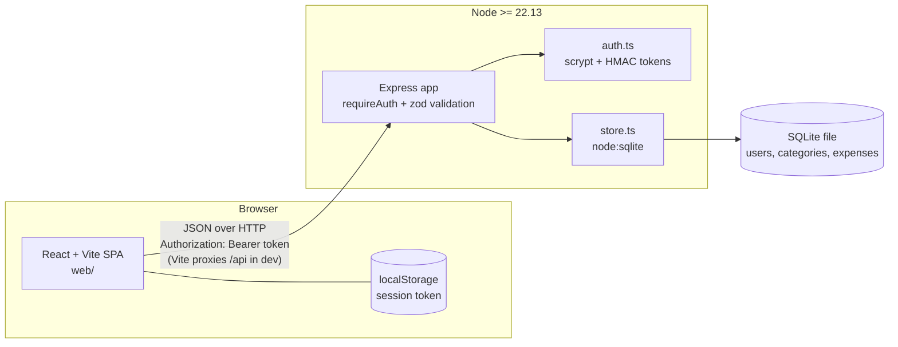

# expense-tracker

A full-stack expense tracker: a TypeScript Express API backed by SQLite, and a React + Vite frontend. Users register, log in, and manage their own expenses, filter them by date range or category, and view a monthly summary with a simple CSS bar chart.

[](https://github.com/beni001994/expense-tracker/actions/workflows/ci.yml)

## Features

- Registration and login. Passwords are hashed with `scrypt` (`node:crypto`, random salt per user).
- Stateless sessions using HMAC-SHA256 signed tokens that expire after 12 hours. No JWT library; the format is about 30 lines in [`api/src/auth.ts`](api/src/auth.ts).
- Per-user expenses (create, read, update, delete) with date-range and category filtering.
- Per-user categories (five defaults are seeded on registration; you can add and delete your own).
- Monthly summary endpoint: total and per-category totals.
- Request validation with [zod](https://zod.dev) and one error shape for every failure.
- SQLite through Node's built-in `node:sqlite`, so there are no native dependencies.
- React frontend: login/register, expense list with add/edit/delete and filters, and a monthly summary with a bar chart built from plain `div`s (no chart library).
- Amounts are stored and transmitted as integer cents to avoid floating point errors.

## Architecture



```
expense-tracker/
├── api/            Express API (TypeScript, ESM)
│   ├── src/        app.ts (routes), auth.ts, config.ts, store.ts, server.ts
│   └── test/       Vitest + Supertest
├── web/            React + Vite frontend
│   └── src/        logic.ts (pure, unit-tested), api.ts, views
└── package.json    npm workspaces root
```

Every query in `store.ts` is scoped by `user_id`, so isolation does not depend on the route layer remembering to filter. A user asking for another user's expense gets `404`, the same as for a record that does not exist.

## API

All routes are under `/api`. Everything except health, register and login requires `Authorization: Bearer <token>`. Dates are `YYYY-MM-DD`, months are `YYYY-MM`, and `amountCents` is a positive integer.

| Method | Path | Description |
| --- | --- | --- |
| GET | `/api/health` | Liveness check |
| POST | `/api/auth/register` | `{ email, password }` (8-200 chars). Returns `{ token, user }`, `409` if the email is taken |
| POST | `/api/auth/login` | `{ email, password }`. Returns `{ token, user }`, `401` on bad credentials |
| GET | `/api/auth/me` | Current user |
| GET | `/api/categories` | List your categories |
| POST | `/api/categories` | `{ name }`. `409` if it already exists (case-insensitive) |
| DELETE | `/api/categories/:id` | `409` if any expense uses it |
| GET | `/api/expenses` | List, newest first. Optional `from`, `to` (inclusive), `categoryId` |
| GET | `/api/expenses/:id` | One expense |
| POST | `/api/expenses` | `{ amountCents, description, date, categoryId }` |
| PUT | `/api/expenses/:id` | Replace an expense (same body as POST) |
| DELETE | `/api/expenses/:id` | `204` on success |
| GET | `/api/summary?month=YYYY-MM` | `{ month, totalCents, categories: [{ categoryId, name, totalCents, count }] }`, largest first |

Errors always look like this:

```json
{ "error": { "code": "validation_error", "message": "Invalid request", "details": [] } }
```

`details` is only present for validation errors (the zod issues). Codes used: `validation_error`, `malformed_json`, `unauthorized`, `invalid_credentials`, `email_taken`, `category_exists`, `category_in_use`, `invalid_category`, `not_found`, `payload_too_large`, `internal_error`.

## Running it

Requires Node.js 22.13 or newer.

```bash
npm install
npm run dev:api     # http://localhost:3000, data in api/expenses.db
npm run dev:web     # http://localhost:5173, proxies /api to the API
```

Then open http://localhost:5173 and register an account.

```bash
npm run typecheck   # both workspaces
npm test            # API (Vitest + Supertest) and web (Vitest) tests
npm run build       # tsc for the API, tsc + vite build for the web app
```

### Configuration

| Variable | Default | Notes |
| --- | --- | --- |
| `SESSION_SECRET` | dev-only constant outside production | **Required** when `NODE_ENV=production`, minimum 32 characters. The server refuses to start otherwise. A warning is logged whenever the dev default is in use. |
| `PORT` | `3000` | |
| `DB_PATH` | `expenses.db` | SQLite file, relative to the working directory |

See [`.env.example`](.env.example). The API does not load `.env` files itself; export the variables or use your process manager. Generate a secret with `node -e "console.log(require('crypto').randomBytes(48).toString('base64url'))"`. No secrets are committed; `*.db` and `.env` are git-ignored.

To run in production-like mode: `npm run build -w api`, then `NODE_ENV=production SESSION_SECRET=... npm start -w api`. The API does not serve the built frontend; put `web/dist` behind any static host or reverse proxy that forwards `/api` to the API.

## Security notes

Handled:

- Passwords are hashed with scrypt (N=16384, r=8, p=1) and a 16-byte random salt, and compared in constant time. Plain passwords are never stored or logged, and password hashes are never returned by the API.
- Session tokens are HMAC-SHA256 signed, carry an expiry, and are verified with a constant-time compare. Tampered, expired, malformed or wrong-secret tokens are rejected (tested).
- A token for a user that no longer exists is rejected.
- Login returns the same error for an unknown email and a wrong password, and does equivalent hashing work for both, to limit account enumeration through timing.
- Authorization: all data access is scoped to the authenticated user in SQL. Cross-user read, update and delete attempts, and using another user's category, are covered by tests.
- Input is validated with zod (types, ranges, real calendar dates). SQL uses parameterised statements only. Request bodies are limited to 16 KB. The `X-Powered-By` header is disabled.
- The production signing secret must come from the environment and be at least 32 characters.

Not handled:

- No rate limiting or account lockout, so online password guessing is not throttled.
- No HTTPS: terminate TLS in front of the API. Tokens sent over plain HTTP can be stolen.
- The frontend keeps the token in `localStorage`, so any XSS bug would expose it. (React escapes output, and the app renders no raw HTML, but there is no Content Security Policy.) An `HttpOnly` cookie with CSRF protection would be stronger.
- Tokens cannot be revoked before they expire, and "log out" only discards the token on the client. There is no refresh flow, so sessions end after 12 hours.
- No email verification, password reset, password change or account deletion.
- No password strength check beyond the 8-character minimum, and no breached-password check.
- No security headers (helmet), CORS configuration, or audit logging. CORS is not needed in development because Vite proxies the API.
- Rotating `SESSION_SECRET` invalidates every session; there is no key-rotation scheme.

## Tests

The API tests (Vitest + Supertest, in-memory SQLite) cover: password hashing and token signing/expiry/tampering, config rules for the secret, auth required on every protected route, duplicate registration and credential errors, expense CRUD, validation failures, cross-user isolation, date and category filtering, category rules, and monthly summary math including month boundaries and leap years. The web tests cover the pure logic in `web/src/logic.ts`: amount parsing, currency formatting, month arithmetic, bar chart geometry and form validation.

There are no component or end-to-end browser tests; the React views are only type-checked and built.

## Limitations

- Single currency (USD formatting). Amounts are not tied to a currency.
- Single SQLite file with synchronous queries; fine for a personal tracker, not for high concurrency.
- No schema migrations: tables are created with `CREATE TABLE IF NOT EXISTS`, so changing the schema later needs a migration step that does not exist yet.
- Categories can be created and deleted through the API, but the frontend only lets you pick from existing categories.
- The summary is monthly only. Dates are plain calendar dates with no time zone handling.
- The expense list is not paginated.
- The signed-in email is shown in the UI only for the current browser session, not after a page reload.
- `node:sqlite` is still marked experimental in Node and prints a warning at startup.

## License

MIT
